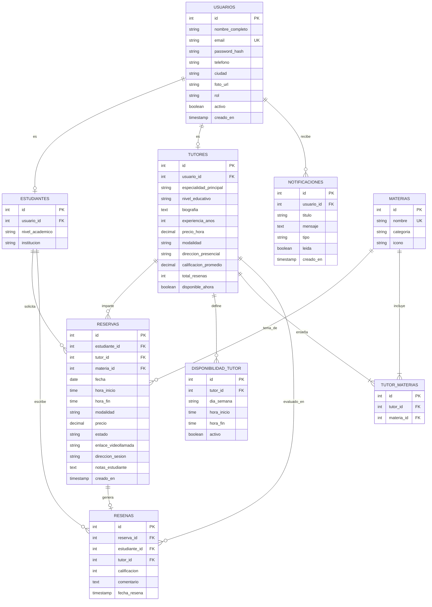

# Diseño de Base de Datos - TutorConnect
**Integrantes:** Daniel Barrios, Eduardo Escudero  
**Materia:** Desarrollo Web - Parcial 2  

---

## 1. Diagrama Entidad-Relación (ER)

---

## 2. Diccionario de Datos

| Tabla | Descripción | Llave Primaria | Llaves Foráneas |
| :--- | :--- | :--- | :--- |
| **`usuarios`** | Cuenta central de acceso con correo y rol (Estudiante / Tutor). | `id` | - |
| **`estudiantes`** | Datos complementarios del perfil del estudiante. | `id` | `usuario_id` → `usuarios(id)` |
| **`tutores`** | Datos profesionales del tutor (tarifa, modalidad, biografía, reputación). | `id` | `usuario_id` → `usuarios(id)` |
| **`materias`** | Catálogo de asignaturas disponibles para filtrar y reservar. | `id` | - |
| **`tutor_materias`** | Relación de muchos a muchos entre profesores y sus áreas de especialidad. | `id` | `tutor_id`, `materia_id` |
| **`disponibilidad_tutor`** | Franjas horarias y días de la semana en los que el profesor atiende citas. | `id` | `tutor_id` → `tutores(id)` |
| **`reservas`** | Registro de citas agendadas con fecha, hora, estado y enlace de videollamada. | `id` | `estudiante_id`, `tutor_id`, `materia_id` |
| **`resenas`** | Calificación (1 a 5 estrellas) y comentarios otorgados al finalizar la sesión. | `id` | `reserva_id`, `estudiante_id`, `tutor_id` |
| **`notificaciones`** | Alertas emitidas por confirmación, recordatorios o cancelaciones de citas. | `id` | `usuario_id` → `usuarios(id)` |
